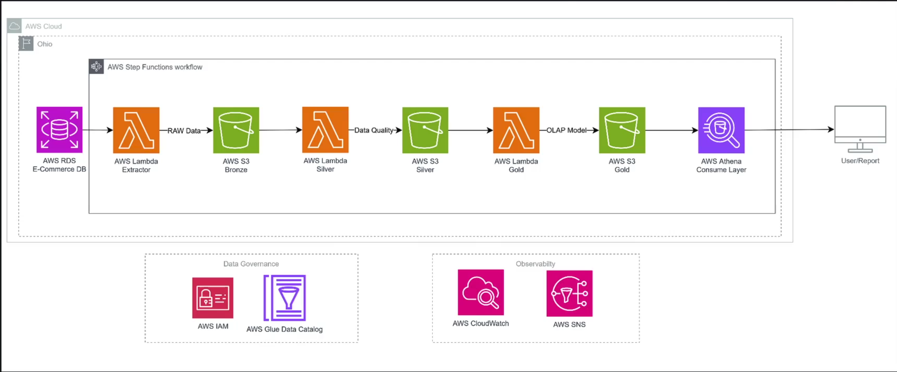

# Alumart — Data Lake na AWS

Pipeline educacional de engenharia de dados que extrai cinco tabelas de um ERP em PostgreSQL, preserva os dados no Amazon S3, aplica regras de qualidade e constrói tabelas analíticas em Parquet.

**Contexto:** projeto desenvolvido no contexto da formação Alura. A documentação descreve o código disponível no material de estudos, sem atribuir autoria exclusiva ou resultados de produção. A revisão foi estática; os serviços não foram implantados ou executados para produzir este README.

## Objetivo

Separar dados operacionais, tratamento e consumo analítico. Clientes, produtos, pedidos, itens e pagamentos percorrem as camadas bronze, silver e gold, com metadados no AWS Glue Data Catalog.

## Arquitetura



Athena é a camada prevista de consulta ao catálogo. A consulta efetiva não foi confirmada no material analisado. O template não representa uma orquestração automática completa entre as três funções.

## Tecnologias e responsabilidades

| Componente | Uso |
|---|---|
| Python e psycopg2 | Consulta ao PostgreSQL e extração |
| boto3 | Acesso a S3, Secrets Manager e Glue |
| pandas e PyArrow | Transformação e serialização Parquet |
| Lambda | Execução das etapas |
| S3 | Armazenamento das camadas |
| Glue Data Catalog | Schemas, tabelas e partições |
| AWS SAM | Empacotamento das funções e layer |

## Estrutura do código

| Caminho relativo à pasta AWS | Responsabilidade |
|---|---|
| `lambda_extract/lambda_function.py` | Extração das cinco tabelas |
| `lambda_transform_silver/lambda_function.py` | Coordenação das regras por tabela |
| `lambda_transform_silver/table_config.json` | Configuração versionada de tratamento |
| `lambda_transform_silver/transforms.py` | Deduplicação, conversões e validações |
| `lambda_transform_silver/storage.py` | CSV de entrada e Parquet de saída |
| `lambda_transform_silver/catalog.py` | Leitura do schema bronze e escrita no catálogo |
| `lambda_transform_gold/` | Builders dimensionais, armazenamento e catálogo |
| `layers/pandas_pyarrow/requirements.txt` | Dependências da layer |
| `template.yaml` | Definição SAM |

As anotações pessoais permanecem em `anotações.md`, separadas da apresentação técnica.

## Contratos de dados

| Origem | Conteúdo | Saída silver |
|---|---|---|
| `erp_hp_clie` | Clientes | `clientes` |
| `erp_it_prod` | Produtos | `produtos` |
| `erp_ov_cabe` | Cabeçalho de pedidos | `pedidos` |
| `erp_ov_item` | Itens de pedido | `itens_pedido` |
| `erp_fn_pgto` | Pagamentos | Definida em `table_config.json` |

A bronze grava `bronze/<tabela>/<tabela>_<YYYYMMDD_HHMMSS>.csv`, com cabeçalho. A extração utiliza `SELECT *` e `fetchall`: cada execução lê a tabela inteira. Não existe CDC nessa etapa.

A silver seleciona nomes de arquivos que contêm a data UTC do dia anterior. Uma extração feita hoje não será consumida imediatamente pela silver de hoje. O evento não oferece substituição da data de referência.

O schema das tabelas bronze no Glue participa da conversão de tipos. Catálogo ausente ou incompatível pode impedir o processamento.

## Regras de tratamento

1. Leitura e concatenação dos CSVs de D−1.
2. Conversão de tipos a partir do catálogo bronze.
3. Deduplicação pelas chaves configuradas.
4. Remoção de referências nulas e validação de formatos.
5. Conversão de datas e padronização de domínios.
6. Cálculo de flags, inclusive verificações entre tabelas.
7. Filtros de validade e escrita em Parquet com Snappy.
8. Registro das tabelas e partições no Glue.

As verificações incluem e-mail, formato de CPF/CNPJ, quantidades e inconsistências de cálculo. Validar formato não comprova a existência ou regularidade cadastral do documento. A ordem das tabelas influencia verificações que usam o cache de dados já processados.

A escrita silver adiciona arquivos com timestamp, sem apagar arquivos anteriores. Isso preserva execuções, mas não torna a extração incremental: ler todo o prefixo pode repetir registros entre cargas.

## Modelo gold

| Tabela | Fontes silver | Política no handler |
|---|---|---|
| `dim_date` | Geração no builder | Substituição |
| `dim_customers` | clientes | Substituição |
| `dim_products` | produtos | Substituição |
| `dim_channels` | pedidos | Substituição |
| `fact_sales` | pedidos, itens_pedido, produtos | Substituição |
| `fact_inventory` | produtos | Append |

`fact_sales` utiliza `order_year_month`; `fact_inventory`, `snapshot_year_month`. Cada invocação gold processa uma única tabela. Não há implementação de SCD tipo 2 neste projeto.

## Configuração e execução

### Pré-requisitos

Python 3.12 conforme o template, AWS CLI, AWS SAM CLI e Docker para build em contêiner. Também são necessários bucket S3, PostgreSQL acessível, secret, subnets e security group válidos. A conexão privada precisa alcançar o banco e os serviços AWS necessários.

O secret deve conter as chaves `host`, `port`, `database`, `username` e `password`. Não incluir seus valores no repositório.

| Variável/parâmetro | Função |
|---|---|
| `SecretName` / `SECRET_NAME` | Identificação do secret |
| `S3Bucket` / `S3_BUCKET` | Bucket das camadas |
| `SubnetIds` | Subnets da extração |
| `LambdaSecurityGroupId` | Security group da extração |
| `GLUE_DATABASE` | Banco silver ou gold |
| `BRONZE_GLUE_DATABASE` | Banco de origem do schema, padrão `bronze` |

Na pasta AWS:

```bash
sam validate
sam build --use-container
sam deploy --guided
```

O deploy cria recursos cobrados e exige permissões de implantação. Informar parâmetros do próprio ambiente. O template contém políticas S3 CRUD amplas para o bucket; elas não equivalem a uma política mínima por prefixo.

Antes da silver, disponibilizar as cinco tabelas bronze no catálogo e o banco silver. O histórico do projeto inclui catalogação manual após bloqueio no crawler; o crawler não é requisito lógico da transformação.

Invocações de exemplo, após implantação:

```bash
aws lambda invoke --function-name lambda_extract_bronze \
  --cli-binary-format raw-in-base64-out --payload '{}' extract-result.json

aws lambda invoke --function-name lambda_transform_silver \
  --cli-binary-format raw-in-base64-out --payload '{}' silver-result.json

aws lambda invoke --function-name lambda_transform_gold \
  --cli-binary-format raw-in-base64-out \
  --payload '{"table":"dim_customers"}' gold-result.json
```

A invocação silver acima depende da existência de arquivos de D−1. Repetir a gold para cada nome de tabela necessário, após verificar as respectivas fontes.

## Observabilidade e validação

A extração retorna contagens e chaves S3. A silver registra linhas bronze, linhas após deduplicação, remoções, falhas de conversão e campos anulados. Cada tabela pode retornar `ok`, `no_data` ou `error`.

**O status HTTP 200 da silver não garante sucesso de todas as tabelas.** A leitura de `body.tables` faz parte da validação. A gold retorna tabela, linhas gravadas, objetos e partições.

Para verificar uma execução, comparar contagens por etapa, inspecionar schemas e partições, conferir flags com registros conhecidos e consultar a saída somente após confirmar acesso ao catálogo. Essas verificações descrevem critérios de aceite, não testes executados nesta revisão.

## Limitações conhecidas

- Leitura em memória, sem validação de capacidade para grandes volumes.
- Seleção D−1 fixa, sem parâmetro de backfill.
- Arquivos silver acumulados podem duplicar snapshots em leituras posteriores.
- Datas inválidas em colunas de particionamento podem ficar fora dos grupos gravados.
- Substituição na gold pode apagar objetos anteriores do prefixo de destino.
- Append de inventário não comprova idempotência de reexecuções.
- Sem confirmação de execução ponta a ponta, consultas Athena ou orquestração implantada.

## Conhecimentos demonstrados

Extração relacional, integração com serviços AWS, separação de camadas, configuração declarativa de qualidade, Parquet, particionamento, catálogo e modelagem dimensional.
