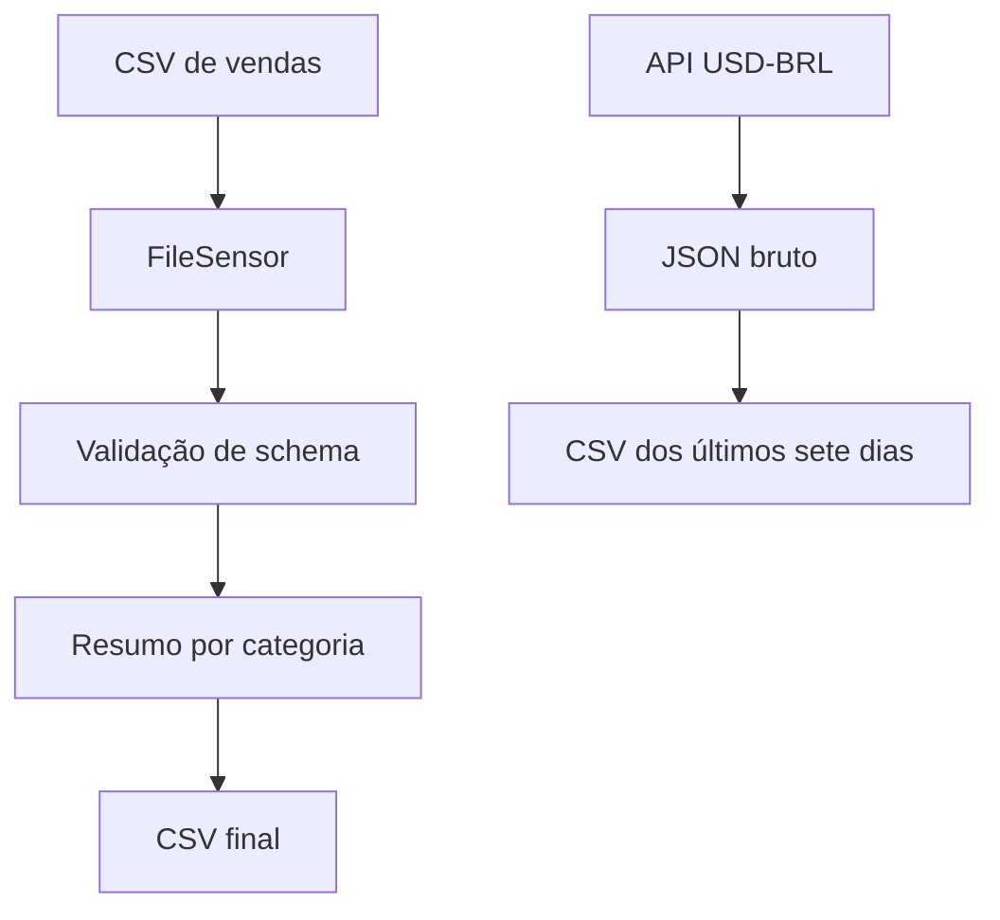

# Vende+ — Orquestração de vendas e cotações com Airflow

Projeto educacional da formação Alura com duas DAGs: processamento de CSV de vendas e coleta de cotação USD-BRL. O foco é explicitar dependências, validar entradas e separar a orquestração das funções de processamento.

A documentação descreve os arquivos analisados. Não houve execução do cluster ou confirmação de envio de alertas nesta revisão.

## Arquitetura



O Compose usa CeleryExecutor, PostgreSQL para metadados, Redis como broker e serviços separados de API, scheduler, DAG processor, worker e triggerer. Esse ambiente é de desenvolvimento local.

## Tecnologias

Python, Apache Airflow, TaskFlow API, pandas, Requests, Docker Compose, PostgreSQL e Redis. A imagem padrão declarada no Compose é `apache/airflow:3.2.1`; compatibilidade dos imports e providers precisa ser verificada no ambiente instalado.

## Organização

| Caminho | Conteúdo |
|---|---|
| `dags/pipeline_vendas.py` | Sensor, extração, transformação e carga |
| `dags/pipeline_cotacao.py` | Coleta e consolidação |
| `helpers/vendas.py` | Validação e agregações |
| `helpers/cotacao.py` | HTTP, JSON bruto e histórico |
| `helpers/callbacks.py` | Notificação por e-mail |
| `scripts/gerar_dados.py` | Geração de CSVs fictícios |
| `docs/specs/` | Especificações dos fluxos |
| `docker-compose.yaml` | Serviços e volumes |
| `anotações.md` | Material pessoal de estudo |

## Pipeline de vendas

O cron é `0 7 * * *`, interpretado no fuso configurado no Airflow. `catchup=False` desabilita a criação automática de execuções históricas. O nome do arquivo usa `ds`, a data lógica da execução, que não deve ser confundida com o horário em que o usuário abriu a interface.

O sensor procura `vendas_<ds>.csv` a cada 60 segundos, por até três horas. Após localizar o arquivo, o fluxo valida a existência de registros e as colunas obrigatórias.

### Entrada

```csv
data,pedido_id,produto,categoria,quantidade,valor_unitario
2026-11-08,P001,Caderno,Papelaria,2,10.00
2026-11-08,P002,Caneta,Papelaria,1,5.00
```

### Transformação e saída ilustrativa

`valor_total = quantidade × valor_unitario`. O agrupamento por categoria calcula a soma e a contagem de linhas de `pedido_id`.

```csv
categoria,total_pedidos,valor_total_brl,ticket_medio_brl
Papelaria,2,25.0,12.5
```

O exemplo foi calculado para explicar a regra; não é uma evidência de execução do Airflow. `total_pedidos` usa `count`, não `nunique`. Portanto, ticket por pedido só é uma interpretação válida quando cada linha representa um pedido distinto.

O arquivo intermediário e o final se chamam `resumo_categoria_<ds>.csv`. Apesar de a docstring falar em mover, a carga lê e grava o CSV, sem excluir o intermediário.

## Pipeline de cotação

- Endpoint no código: `https://economia.awesomeapi.com.br/last/USD-BRL`.
- Timeout de 30 segundos e tratamento de erro HTTP.
- Validação de `USDBRL`, `bid`, `ask`, `high`, `low` e `create_date`.
- JSON em `/opt/airflow/data/cotacao/raw/cotacao_<data>.json`.
- Consolidado em `/opt/airflow/data/cotacao/consolidated/historico_7dias.csv`.

A DAG usa `schedule=None`: a execução é manual. A janela considera a data do relógio do processo, não a data lógica da DAG. Sete dias de janela não significam sete registros se faltarem arquivos.

**Limitação semântica:** o código nomeia `bid` como abertura e `ask` como fechamento. Esses campos são preços de compra e venda e não constituem uma série OHLC válida. O CSV atual precisa ser interpretado com essa restrição.

## Preparação do ambiente local

Pré-requisitos: Docker e Compose, recursos para os serviços e Python para gerar dados fictícios. O próprio Compose verifica disponibilidade de aproximadamente 4 GB de memória, 2 CPUs e 10 GB de disco.

Executar na pasta `Apache Airflow/vende-mais-airflow`:

```bash
mkdir -p logs config plugins data
```

Criar um `.env` local com `AIRFLOW_UID` correspondente ao usuário Linux, uma chave Fernet válida em `FERNET_KEY` e credenciais locais de administração. Não versionar esse arquivo. O Compose exige `.env` e define valores locais padrão de usuário e senha; não expor a porta 8080 à internet.

```bash
docker compose config --quiet
docker compose up airflow-init
docker compose up -d
docker compose ps
```

A interface fica em `http://localhost:8080`. Utilizar as credenciais configuradas na inicialização.

### Configurações do Airflow

| Variable | Valor local proposto |
|---|---|
| `vendas_dir_input` | `/opt/airflow/data` |
| `vendas_dir_temp` | `/opt/airflow/data/temp` |
| `vendas_dir_output` | `/opt/airflow/data/output` |
| `email_alertas` | Endereço de teste controlado pelo operador |

Criar a conexão de filesystem `fs_default`, compatível com o FileSensor instalado e com caminho base `/`. Os caminhos de entrada são absolutos dentro dos contêineres.

Os helpers ficam montados em `/opt/airflow/helpers`. Se houver erro `No module named helpers`, assegurar que `/opt/airflow` faça parte do `PYTHONPATH` de todos os serviços que importam ou executam as DAGs. Se um import de Airflow não existir na imagem declarada, alinhar os imports/providers à versão antes de executar; esta documentação não altera o código.

### Execução

```bash
python3 scripts/gerar_dados.py
docker compose exec airflow-scheduler airflow dags list-import-errors
```

O gerador cria arquivos para hoje e os dois dias anteriores. Na interface, habilitar `pipeline_vendas` e conferir o `ds` do run escolhido. O arquivo precisa corresponder exatamente a essa data. Acionar `pipeline_cotacao` manualmente.

Para interromper os serviços preservando o volume do banco:

```bash
docker compose down
```

## Falhas e observabilidade

As tarefas têm uma repetição após um minuto e callback `notificar_falha`. O callback lê `email_alertas` e chama o mecanismo de e-mail do Airflow. A entrega depende da configuração SMTP e das credenciais do ambiente. O Compose traz host e porta, mas isso não comprova autenticação funcional.

Logs mostram arquivo, quantidade de linhas e destino. O retorno da extração transmite metadados à tarefa de carga; os DataFrames não são transportados entre tarefas.

## Critérios de validação

| Caso | Comportamento a verificar |
|---|---|
| CSV válido | Resumo por categoria e soma esperada |
| CSV ausente | Sensor aguarda e expira no limite |
| Coluna obrigatória ausente | Falha na validação |
| CSV sem registros | Falha na validação |
| API com erro HTTP | Falha na coleta e retry |
| SMTP indisponível | Registro da falha de notificação |

Esses critérios não representam testes realizados nesta revisão.

## Limitações

Sem validação completa dos tipos e domínios do CSV. Contagem de linhas em vez de pedidos distintos. Datas de cotação baseadas no relógio. Escrita do JSON substitui a coleta anterior do mesmo dia. Consolidação sem registros pode falhar ao ordenar a coluna `data`. Não há evidência de implantação em produção ou teste de recuperação ponta a ponta.

## Conhecimentos demonstrados

Dependências entre tarefas, sensores, data lógica, agendamento, validação de schema, integração HTTP, preservação de dados brutos, callbacks, retries e ambientes em contêineres.
