# Arquiteturas de Dados Modernas - DW, Data Lake e Lakehouse

## OLTP

O OLTP é o sistema responsável por registrar as operações do dia a dia de uma empresa, como registrar um pedido, atualizar um inventário, processar um pagamento ou cadastrar um cliente. Ele garante que as operações ocorram de forma correta, rápida, segura e consistente, sendo o "coração do negócio".

As características fundamentais de um sistema OLTP são:

- **Alta concorrência**: Lida com muitos usuários e transações simultâneas sem corromper os dados.
- **Baixa latência**: Otimizado para operações rápidas e específicas, com respostas em milissegundos.
- **Dados normalizados**: Organiza os dados em tabelas separadas para evitar redundância e garantir a integridade.
- **Transações ACID**: Garante a confiabilidade do sistema através de Atomicidade, Consistência, Isolamento e Durabilidade.

## OLAP

O OLAP é o sistema que analisa o passado, transformando dados brutos em informações úteis para a tomada de decisões estratégicas. Enquanto o OLTP responde a perguntas específicas sobre registros individuais ("Qual é o pedido 1050?"), o OLAP responde a perguntas sobre padrões e tendências agregadas ("Qual foi a faturação total de março?").

As principais características do OLAP incluem:

- **Análise de grandes volumes de dados históricos**: Ele trabalha com meses, anos ou até décadas de informações para identificar tendências.
- **Consultas complexas**: Utiliza funções de agregação (soma, média, contagem) e agrupamentos (por mês, categoria, região) para análises aprofundadas.
- **Modelagem de dados orientada à leitura**: Prioriza o desempenho de leitura, utilizando estruturas como modelo estrela, tabelas de fatos e tabelas de dimensão, que serão aprofundadas em vídeos futuros.
- **Escritas em lotes programados**: Diferente do OLTP, onde ocorrem milhares de escritas simultâneas, no OLAP as escritas são menos frequentes e ocorrem em lotes.

### Os principais pontos abordados foram:

- **Tipo de Perguntas**: OLTP responde a perguntas pontuais e operacionais (ex: endereço de um cliente, status de pagamento), enquanto OLAP responde a perguntas agregadas e estratégicas (ex: faturamento total do mês, crescimento de categoria).
- **Carga de Trabalho**: OLTP lida com muitas pequenas transações simultâneas (inserções, atualizações) com foco em baixa latência e consistência. OLAP tem menos escritas, mas muitas consultas pesadas que percorrem grandes volumes de dados para agregações.
- **Modelagem de Dados**: OLTP prioriza a normalização para evitar redundância e garantir integridade. OLAP aceita redundância e utiliza modelagem multidimensional (modelo estrela, tabela de fatos e dimensões) para facilitar e acelerar consultas analíticas.
- **Tipos de Usuários**: OLTP é usado por clientes e operadores, focado na experiência do usuário final e operações diárias. OLAP é para analistas de negócios, gestores e cientistas de dados, influenciando decisões estratégicas.
- **Exemplo da Minishop**: A aula ilustrou como um e-commerce como a Minishop teria um ambiente OLTP para gerenciar pedidos, clientes e estoque, e um ambiente OLAP para analisar vendas, faturamento e crescimento.
- **Importância da Separação**: Foi enfatizado que misturar cargas OLTP e OLAP no mesmo ambiente é um erro clássico, pois as consultas analíticas podem sobrecarregar o sistema operacional e impactar o usuário final. A separação é uma necessidade arquitetônica.

### Diagrama de Chen

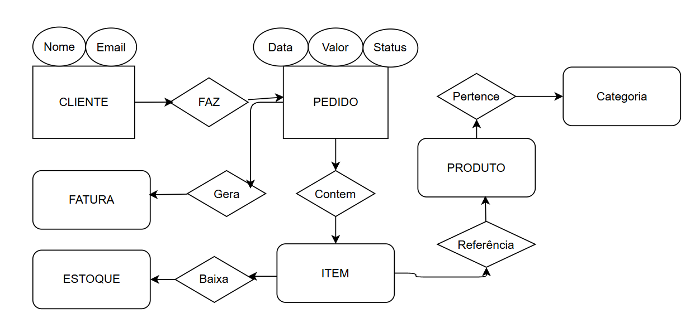
> Esquema de banco de dados OLTP relacional normalizado para evitar redundância e garantir a integridade dos dados.

## Data Warehouse (DW)

O DW resolve o problema de executar consultas complexas diretamente no banco de dados transacional, o que poderia degradar o desempenho do sistema.

### As quatro características fundamentais de um Data Warehouse, segundo Bill Inmon, são:

- **Orientado por temas**: Foca em temas de análise (vendas, clientes, produtos) em vez de processos operacionais.
- **Integrado**: Consolida e padroniza dados de diversas fontes para criar uma "versão única da verdade".
- **Não volátil**: Preserva o histórico dos dados, sem alterar registros antigos, garantindo estabilidade analítica.
- **Variável no tempo**: Permite analisar a evolução do negócio ao longo do tempo, transformando dados operacionais em memória corporativa.

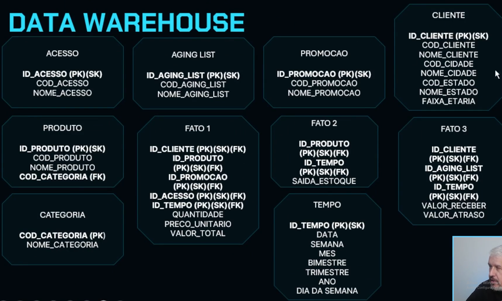

## Fundamentos da Modelagem Multidimensional

No modelo relacional tradicional (OLTP), que é para o dia a dia da loja, você registra cada venda como uma linha em um caderno. Cada linha tem o produto vendido, o preço, a data, o cliente, etc. É ótimo para registrar transações e garantir que tudo esteja correto, mas se você quiser saber "quantos produtos X foram vendidos na região Sul no mês de abril?", teria que folhear muitas páginas e fazer várias contas. É como ter um diário detalhado de cada evento.

Agora, no modelo multidimensional (para o Data Warehouse), a ideia é diferente. Em vez de um diário, pense em um cubo mágico ou em uma tabela dinâmica muito poderosa.

O que queremos analisar (Indicadores)? São os números que você quer medir. No nosso cubo mágico, seriam os valores que preenchem o interior do cubo. Por exemplo:

Total de vendas
Quantidade de produtos vendidos
Lucro
Custo
Como queremos analisar (Dimensões)? São as "faces" ou os "eixos" do seu cubo mágico. Cada face representa uma perspectiva pela qual você pode olhar seus indicadores. Por exemplo:

Dimensão Tempo: Você pode olhar as vendas por ano, mês, dia, semana.
Dimensão Produto: Você pode olhar as vendas por tipo de produto, categoria, marca.
Dimensão Cliente: Você pode olhar as vendas por tipo de cliente, região do cliente, idade do cliente.
Dimensão Localização: Você pode olhar as vendas por loja, cidade, estado.
A modelagem multidimensional é como montar esse cubo mágico: você define quais são os números importantes (indicadores) e quais são as lentes ou perspectivas pelas quais você quer analisar esses números (dimensões).

Quando você quer responder à pergunta "quantos produtos X foram vendidos na região Sul no mês de abril?", no seu cubo mágico, você simplesmente "gira" as faces para as dimensões "Produto X", "Região Sul" e "Mês de Abril", e o valor (o indicador de quantidade de vendas) já está lá, pronto para ser lido.

Em resumo:

Modelo Relacional (OLTP): Foca em registrar cada detalhe das transações. É como um livro-caixa detalhado.
Modelo Multidimensional (Data Warehouse): Foca em organizar os dados de forma que as análises e as perguntas de negócio sejam respondidas de forma rápida e intuitiva. É como um painel de controle interativo ou um cubo mágico de informações.

### Os modelos clássicos de implementação dimensional são:

#### Modelo Estrela

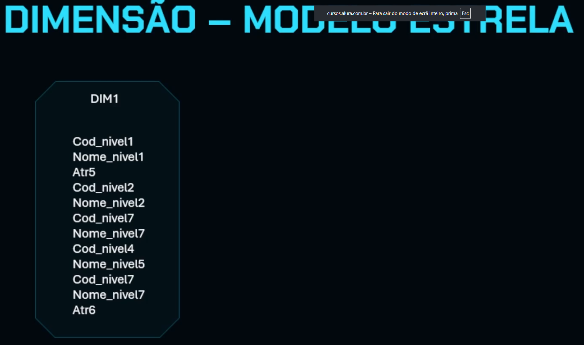
É o mais comum e simples. Nele, cada dimensão é uma única tabela desnormalizada, contendo todos os atributos e níveis hierárquicos. No centro, fica a tabela de fatos, que se conecta a todas as dimensões e armazena os indicadores. A principal vantagem é a simplicidade das consultas e o melhor desempenho, pois exige menos joins. A desvantagem é a redundância de dados e a dificuldade em atualizar a estrutura das dimensões.

#### Modelo Snowflake (Floco de Neve)

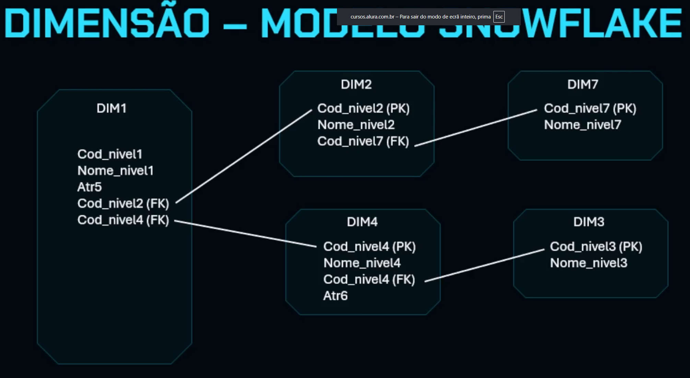
Neste modelo, as tabelas de dimensão são normalizadas. Os níveis hierárquicos são distribuídos em múltiplas tabelas que se relacionam entre si. Isso reduz a redundância de dados e facilita a manutenção estrutural das dimensões. No entanto, aumenta a complexidade das consultas e o número de joins necessários.

`Tipos de hierarquias:`

**Hierarquias Regulares**: São aquelas em que todos os membros de um nível inferior percorrem o mesmo número de níveis até chegar ao topo (ex: Cidade -> Estado -> País). Ambos os modelos estrela e snowflake funcionam bem para elas.

**Hierarquias Irregulares**: São aquelas em que alguns membros podem pular níveis hierárquicos (ex: uma cidade que se liga diretamente a um país, sem um estado intermediário). O modelo snowflake tem dificuldade em representar essas hierarquias, enquanto o modelo estrela pode representá-las permitindo valores nulos nas colunas dos níveis ausentes.

**Modelo Pai-Filho**: como uma solução para representar hierarquias complexas e irregulares. Nele, cada linha da tabela representa uma relação hierárquica entre dois elementos (pai e filho), independentemente do nível. A vantagem é a flexibilidade para qualquer estrutura hierárquica, mas a desvantagem é a complexidade das consultas, que exigem operações mais elaboradas como joins recursivos.

## Criando o Dw do Minishop

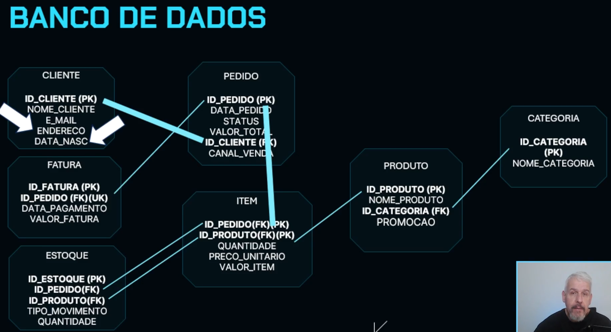

## Matriz de Dimensão

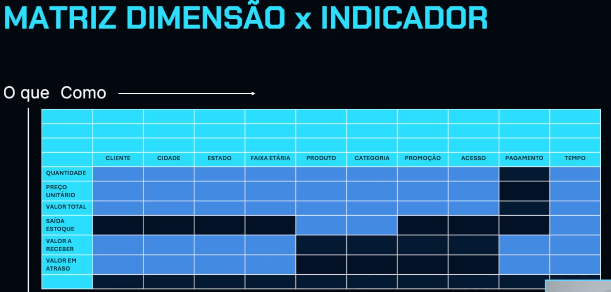

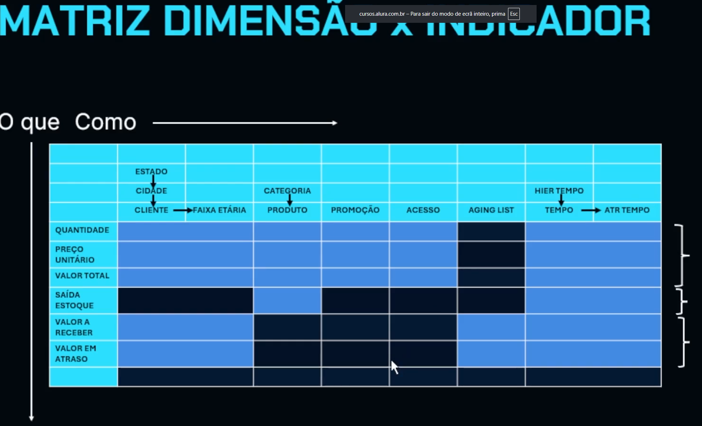

### Atributos degenerados

Um atributo degenerado é uma característica que existe na tabela de fatos, mas que não pertence diretamente a uma dimensão. Não há uma justificativa para criar uma dimensão própria para ele.

Um exemplo clássico é o número de pedido ou o número do documento fiscal. Essas informações estão diretamente associadas à ocorrência do fato, mas não representam uma entidade analítica que justifique uma dimensão separada. Por isso, elas permanecem na própria tabela de fatos.

É importante usar atributos degenerados com cautela, pois adicionar muitos deles pode aumentar o volume e a largura da tabela de fatos, impactando o desempenho, especialmente em cenários de grande escala. O modelo dimensional deve priorizar informações relevantes para a análise, e não reproduzir processos operacionais.

### Surrogate Keys

No modelo dimensional, não usamos as chaves naturais (os identificadores originais dos sistemas transacionais) para identificar os membros das dimensões. Em vez disso, criamos uma chave substituta, que geralmente é um número sequencial inteiro. Essa chave não tem um significado para o negócio, mas é crucial dentro do data warehouse.

#### Importância das chaves substitutas:

- **Eficiência em joins**: Realizar joins (conexões) entre tabelas usando números inteiros é muito mais eficiente do que usar textos, códigos longos ou chaves compostas. Isso é fundamental quando lidamos com milhões ou bilhões de linhas na tabela de fatos.

- **Otimização de espaço e indexação**: Números inteiros ocupam menos espaço em disco, o que facilita a indexação e melhora o desempenho das consultas.

- **Simplificação do modelo**: A chave substituta simplifica o modelo, pois é ela que liga a dimensão à tabela de fatos, e não o código original do sistema operacional.

- **Consistência**: Garante uma identificação única e consistente para cada membro do nível folha da dimensão.

A chave substituta aparece tanto na dimensão (como chave primária do nível folha) quanto na tabela de fatos (como chave estrangeira), conectando cada evento da tabela de fatos ao membro correspondente da dimensão.

## ETL (Extract, Transform, Load)

O processo de ETL é o que realmente operacionaliza o Data Warehouse, transformando o modelo teórico em um sistema analítico funcional e contínuo.

- **A Necessidade do ETL**: Um Data Warehouse, por mais bem modelado que seja, não tem valor sem dados. O ETL é o processo que preenche o Data Warehouse com informações, transformando-o de um projeto em um sistema analítico vivo.

- **Ponte entre OLTP e Data Warehouse**: O ETL faz a conexão entre os sistemas operacionais (OLTP), que registram as transações do dia a dia, e o Data Warehouse, que é focado na análise e consolidação de histórico.

- **Integração de Múltiplas Fontes**: O Data Warehouse não se limita a dados de um único OLTP. Ele pode integrar informações de diversas fontes, como APIs, Web Services, bancos de dados de parceiros e até mesmo arquivos locais (planilhas, textos), para construir uma visão analítica unificada.

- **As Três Etapas do ETL**:
  - **Extract (Extração)**: É a fase de coleta dos dados das fontes de origem (bancos de dados, arquivos, APIs). O foco aqui é capturar os dados de forma confiável, sem aplicar regras de negócio complexas ainda.
  - **Transform (Transformação)**: Esta é a etapa mais crucial, onde os dados operacionais são preparados para o ambiente analítico. Inclui a aplicação de regras de negócio, padronização de formatos, tratamento de inconsistências, correção de dados inválidos e a criação de novos atributos analíticos. É também onde as chaves operativas são convertidas em surrogate keys.
  - **Load (Carga)**: Na fase final, os dados já transformados são inseridos nas tabelas de dimensão e de fatos do Data Warehouse. Mecanismos de controle, como gestão de históricos e verificação de integridade, são aplicados para garantir a confiabilidade das análises.

- **Data Warehouse não é cópia do OLTP**: É um erro comum pensar que o Data Warehouse é apenas uma cópia do banco de dados operacional. O objetivo do Data Warehouse é diferente (análise de negócio), e por isso os dados são reorganizados e transformados.

- **Surrogate Keys e Lookup**: As surrogate keys são códigos sequenciais que identificam os membros das dimensões. O processo de ETL gera essas chaves a partir dos códigos naturais e as utiliza para substituir os códigos naturais dos sistemas operacionais nas tabelas de fatos, um processo chamado Lookup.

- Exemplo de Lookup antes do preenchimento

- Exemplo de Lookup com dimensão preenchida

- **Slowly Changing Dimensions (SCD Type 2)**: Em alguns casos, como nas SCD Type 2, quando um atributo relevante de um registro muda (ex: endereço de um cliente), uma nova linha é criada na dimensão em vez de atualizar a existente. Isso permite preservar o histórico completo das mudanças e garantir que as análises reflitam o contexto de cada período.

- **Cargas Iniciais e Incrementais**:
  - **Carga Inicial**: Popula o Data Warehouse pela primeira vez, carregando todo o histórico disponível das fontes.
  - **Carga Incremental**: Ocorre após a carga inicial, mantendo o Data Warehouse atualizado ao inserir apenas novos dados ou modificações desde a última carga.

### Dimensão tempo

Apresentamos três enfoques para garantir a integridade das datas:

- **Enfoque preguiçoso**: Criar um período muito amplo de datas fixas na dimensão. Embora garanta que nenhuma data falte, pode criar muitos registros desnecessários.
- **Gerar apenas as datas que aparecem na tabela de fatos**: Mais eficiente, mas pode criar lacunas na dimensão, prejudicando a visualização de séries históricas.
- **Equilíbrio (melhor estratégia)**: Identificar a data mínima e máxima na tabela de fatos e gerar todos os dias contínuos nesse intervalo. Isso evita datas desnecessárias e garante uma série temporal contínua.

### Carga incremental baseada na chave natural

> Atualiza ou insere registros com base em uma chave natural clara e única.

### Carga incremental baseada na combinação de chaves substitutas das dimensões

> Usada quando a tabela de fatos não tem uma chave natural própria.

### Reprocessamento baseado no período de tempo

> Elimina todos os dados de um período específico da tabela de fatos e, em seguida, recarrega todos os dados desse período novamente. Essa estratégia lida com novos registros, modificações e exclusões de forma eficaz, mas exige a leitura completa do período.

### Processos de ETL

- Cargas dimensionais

- Carga 1

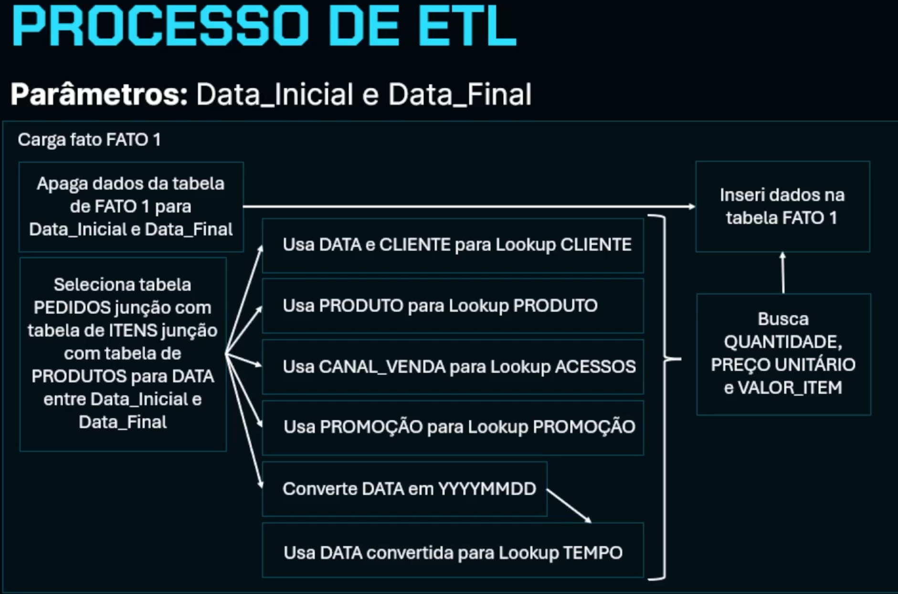

- Carga 2

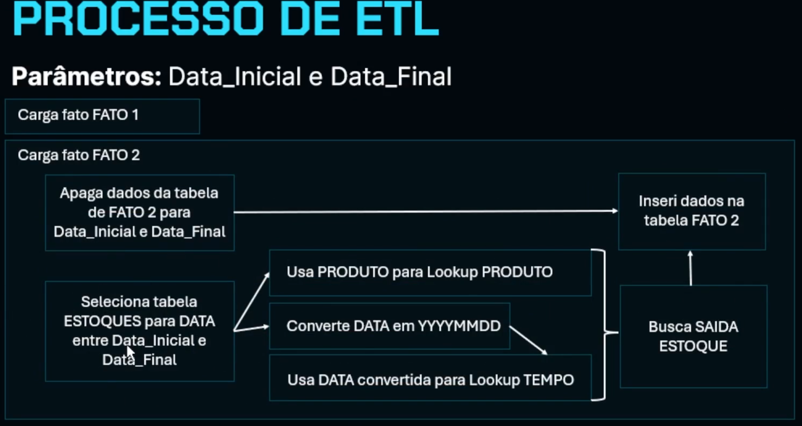

- Carga 3

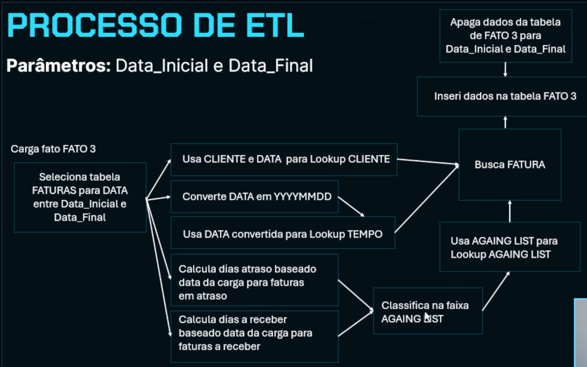

## Data Lake

O Data Lake (DL) é um repositório centralizado que armazena grandes volumes de dados brutos, de diversas fontes e em seus formatos originais. Pense nele como um "grande lago" onde todos os tipos de dados (estruturados, semiestruturados e não estruturados) são despejados sem a necessidade de uma estrutura pré-definida.

Ele serve para:

- **Armazenar dados brutos**: Preserva os dados exatamente como foram gerados, permitindo que sejam usados para análises futuras, mesmo que a finalidade inicial não seja clara.
- **Flexibilidade**: Permite trabalhar com diferentes tipos de dados e formatos (JSON, logs, CSV, etc.) sem a rigidez de um Data Warehouse tradicional.
- **Ingestão rápida**: Como não exige transformações prévias, a ingestão de dados é muito mais ágil.
- **Base para análises avançadas**: Serve como fonte para Data Warehouses, Data Marts e outras ferramentas analíticas, além de ser ideal para machine learning e inteligência artificial, que muitas vezes precisam de dados em seu estado bruto.
- **Reprocessamento**: Se uma regra de negócio mudar ou uma nova análise for necessária, os dados brutos estão disponíveis para serem reprocessados sem a necessidade de voltar às fontes originais.

Em resumo, o Data Lake é uma peça fundamental nas arquiteturas de dados modernas, oferecendo flexibilidade e capacidade de armazenamento para lidar com o volume e a variedade de dados atuais.

### Arquitetura do Data Lake

#### Organização em camadas

- **Bronze** - Camada de entrada
- **Prata** - Camada de qualidade
- **Ouro** - Camada de negócio

**Camada RAW ou Bronze**: Esta é a primeira camada. Nela, os dados são armazenados exatamente como chegam das fontes originais, sem nenhuma transformação. É como se fosse o "estado bruto" dos dados.

**Camada Staged ou Prata**: Nesta segunda camada, os dados passam por uma transformação inicial. Isso pode incluir limpeza, padronização de formatos ou conversão para formatos mais eficientes para processamento, como Parquet ou ORC.

**Camada Curated ou Ouro**: A terceira e última camada é onde os dados já estão organizados e preparados para o consumo analítico. Aqui, os dados estão prontos para serem usados em dashboards, projetos de ciência de dados ou para alimentar o Data Warehouse.

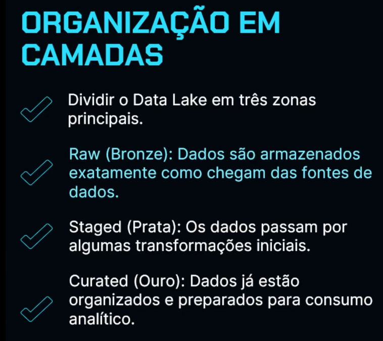

- Quem usa o DL?

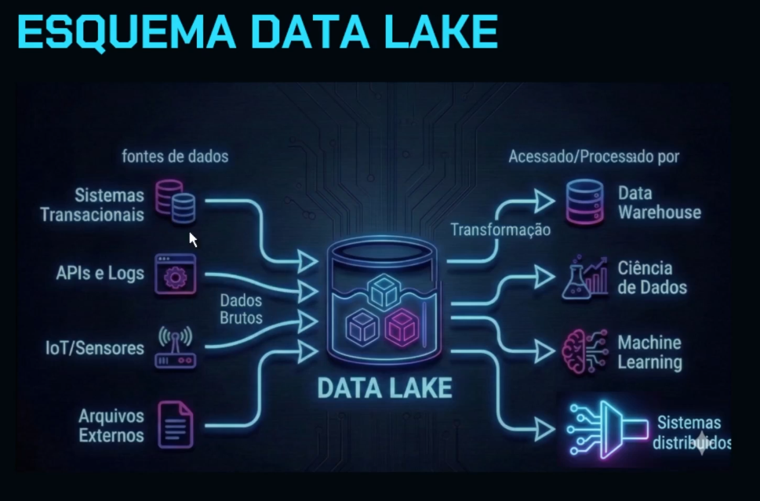

### Fluxos de Dados com Data Lake

A principal mudança que o Data Lake traz para a arquitetura de dados é a alteração no fluxo de transporte e transformação dos dados. Em arquiteturas clássicas, o processo era ETL (Extrair, Transformar e Carregar), onde as transformações ocorriam antes do armazenamento analítico. Com o Data Lake, a lógica muda para EL (Extrair e Carregar), onde os dados são primeiro carregados no Data Lake em seu formato original e só depois passam por processos de transformação.

Essa abordagem traz vantagens como a preservação dos dados brutos, permitindo reprocessamento e maior flexibilidade. Além disso, há uma separação mais clara entre a ingestão e a transformação dos dados, tornando a arquitetura mais modular e escalável. O Data Lake também se torna um ponto central para diferentes consumidores, como cientistas de dados e engenheiros de Machine Learning, além de alimentar o Data Warehouse.

### Data Lake no Minishop

Formatos de arquivo muito utilizados em Data Lakes:

- **Parquet**: Um formato de código aberto, colunar binário, otimizado para desempenho analítico, que ocupa menos espaço em disco e permite leituras rápidas.
- **Avro**: Um formato de serialização de dados binários, eficiente para armazenar e trocar grandes volumes de dados, que guarda os dados e o esquema (em JSON) no mesmo arquivo ou separadamente.

> **Camada Bronze**

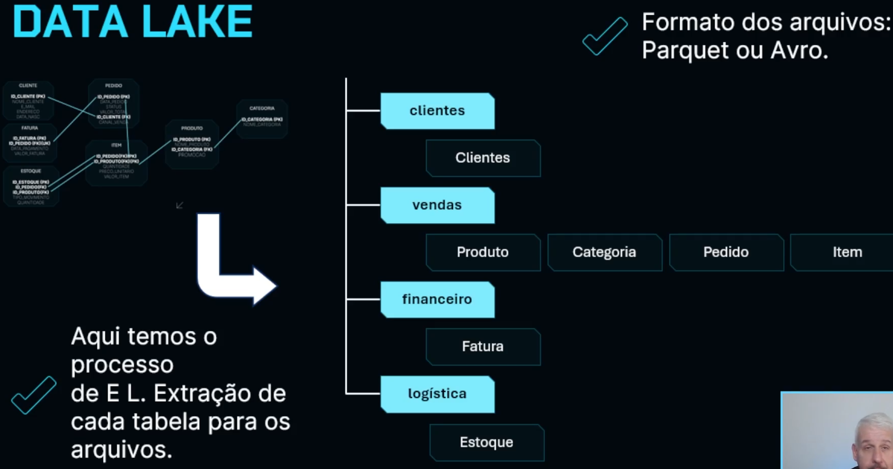

> **Camada Prata**

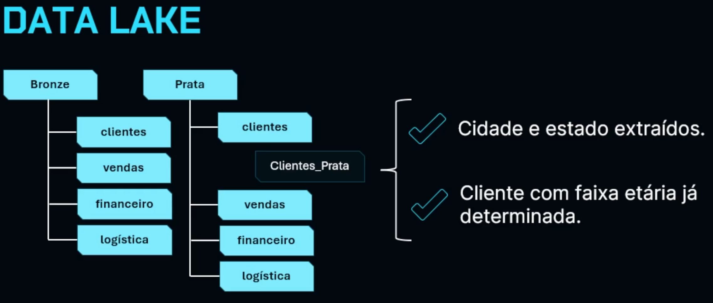

> **Camada Ouro**

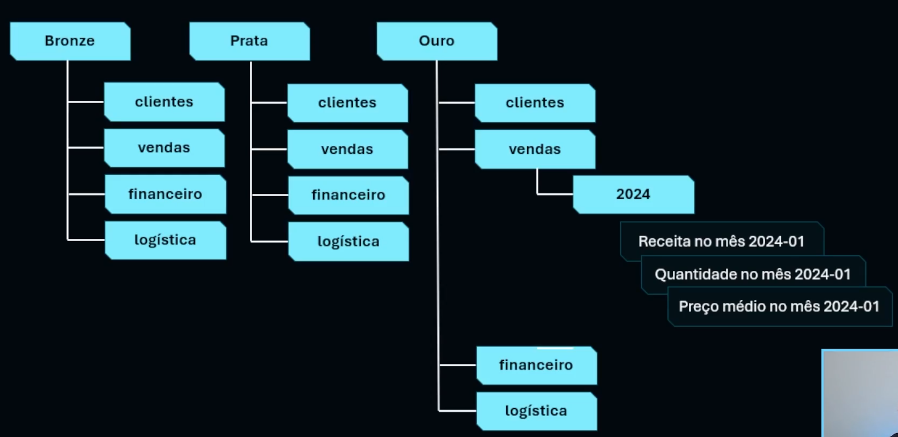

## Data Lakehouse

O Lakehouse propõe que os dados continuem armazenados no Data Lake de forma bruta, mas sejam organizados e acessados como se fossem tabelas analíticas. Isso permite realizar consultas analíticas diretamente sobre os dados no próprio Data Lake, eliminando a necessidade de mover continuamente os dados para um Data Warehouse.

As vantagens dessa abordagem incluem manter o armazenamento escalável e de baixo custo do Data Lake, enquanto incorpora a organização de dados em estruturas que podem ser consultadas como tabelas. Isso possibilita executar consultas SQL, aplicar governança, controlar versões e estruturar datasets para análise, transformando o Data Lake em uma plataforma analítica mais poderosa.

> O Lakehouse não necessariamente substitui o Data Lake ou o Data Warehouse, mas surge como uma evolução para reduzir movimentações desnecessárias de dados, simplificar a arquitetura e aproveitar melhor as ferramentas modernas de processamento distribuído.

### Arquitetura do Lakehouse

Imagine que você tem uma biblioteca enorme, cheia de livros de todos os tipos, organizados de forma bem flexível. Essa é o seu Data Lake, onde os dados (livros) estão guardados em arquivos, de forma escalável e com baixo custo.

Agora, pense que você quer fazer uma pesquisa específica nessa biblioteca, como encontrar todos os livros de um determinado autor ou sobre um assunto específico. Se os livros estivessem em formatos comuns, como folhas soltas, seria difícil e demorado.

É aí que entra a arquitetura Lakehouse. Ela é como se você adicionasse algumas ferramentas e um sistema de organização inteligente à sua biblioteca:

- **Formatos de arquivos otimizados**: É como se os seus livros estivessem em formatos especiais (como Parquet ou Avro), que permitem que você encontre rapidamente as informações que precisa, sem ter que ler o livro inteiro. Eles são projetados para leituras eficientes.
- **Catálogo de metadados**: Pense nisso como um índice super detalhado da sua biblioteca. Ele não guarda os livros em si, mas sabe exatamente onde cada livro está, qual é o seu formato, quais são os capítulos (esquema das colunas) e outras informações importantes. Ferramentas como Hive Metastore ou AWS Glue Catalog fazem esse papel.
- **Motores de processamento analítico**: São como pesquisadores muito rápidos e eficientes que sabem usar o índice (catálogo de metadados) e os formatos especiais dos livros para encontrar e analisar as informações que você pediu. Eles podem executar consultas complexas diretamente nos seus livros (dados do Data Lake) sem precisar movê-los para outro lugar. Exemplos são Apache Spark, Trino, Presto ou DukeDB.

Ao combinar esses três elementos, o Lakehouse transforma sua "biblioteca flexível" (Data Lake) em um ambiente onde você pode fazer pesquisas e análises complexas de forma eficiente, como se estivesse usando uma "biblioteca super organizada e especializada" (Data Warehouse), mas mantendo a flexibilidade e o baixo custo da sua biblioteca original.

## Papéis do Data Lake, Data Warehouse e Lakehouse

Vamos a um exemplo prático para ilustrar os papéis:

Imagine uma grande empresa de e-commerce que vende produtos online.

> **Data Lake (Camada Ouro)**

- **Exemplo**: A empresa coleta todos os dados de cliques dos usuários no site, histórico de navegação, produtos visualizados, dados de sensores de estoque e logs de servidores. Esses dados brutos são armazenados no Data Lake. Após um processo inicial de limpeza e padronização (por exemplo, remover dados duplicados, padronizar formatos de data e extrair informações básicas de endereço), esses dados são movidos para a camada ouro do Data Lake.

- **Papel**: Nesta camada, os cientistas de dados podem explorar esses dados para entender padrões de comportamento do cliente, construir modelos de recomendação de produtos ou identificar anomalias no tráfego do site. Os dados estão organizados por domínio (ex: dados de clientes, dados de produtos), mas ainda não estão em um modelo analítico rígido.

> **Data Warehouse**

- **Exemplo**: Para relatórios financeiros mensais, a empresa precisa saber o faturamento exato por categoria de produto, a margem de lucro por região e o desempenho de vendas por vendedor. Esses dados são extraídos do Data Lake (ou de outras fontes), transformados e carregados no Data Warehouse em um modelo de fatos e dimensões. Por exemplo, teríamos uma tabela de fatos de vendas e tabelas de dimensões para tempo, produto, cliente e região.

- **Papel**: O Data Warehouse garante que esses relatórios sejam consistentes, confiáveis e que as métricas de negócio (como "faturamento" ou "margem de lucro") sejam calculadas da mesma forma sempre. É o ambiente para os "indicadores oficiais" da empresa e dashboards executivos.

> **Lakehouse**

- **Exemplo**: A equipe de marketing quer analisar rapidamente o impacto de uma nova campanha promocional sobre o volume de vendas de um produto específico, cruzando dados de cliques no site (que estão no Data Lake) com dados de vendas (que poderiam estar no Data Warehouse ou também no Data Lake). Eles precisam de uma consulta SQL rápida sobre grandes volumes de dados que ainda estão em arquivos no Data Lake, sem ter que esperar que esses dados sejam totalmente modelados e carregados em um Data Warehouse tradicional.

- **Papel**: O Lakehouse permite que a equipe de marketing execute consultas SQL complexas diretamente sobre os arquivos do Data Lake, como se fossem tabelas, aproveitando a escalabilidade do Data Lake e a capacidade analítica do SQL. Isso evita a duplicação de dados e agiliza a análise de grandes volumes de informações que não precisam de um modelo multidimensional tão rígido quanto o do Data Warehouse.

> **Em resumo**, o Data Lake (camada ouro) é para dados preparados para exploração, o Data Warehouse é para relatórios e métricas de negócio estruturadas, e o Lakehouse é para análises SQL diretas sobre grandes volumes de dados no Data Lake, reduzindo a movimentação e duplicação.

## Arquitetira final do Minishop

> **Data Lakehouse no Minishop**

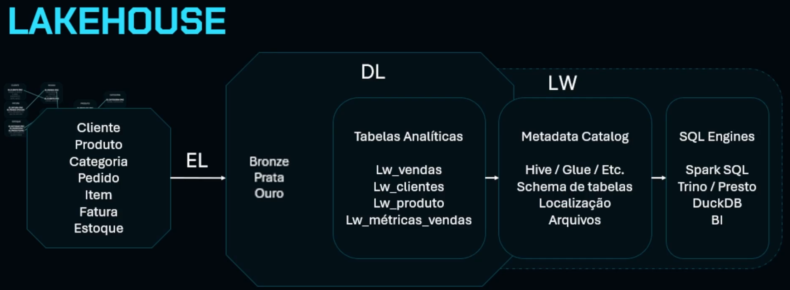

> **Data Warehouse no Minishop**

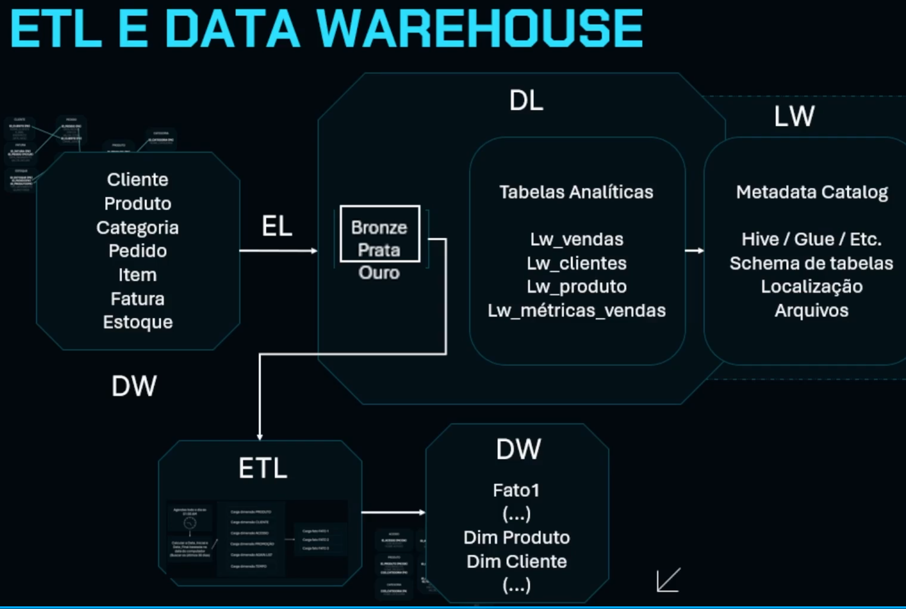

## A camada semântica

Imagine que você está em um restaurante muito grande e sofisticado, com uma cozinha enorme e complexa (que seria o seu Data Warehouse ou Lakehouse, onde os dados brutos e preparados estão). Nessa cozinha, os ingredientes (dados) são armazenados e processados de diversas formas, mas tudo está em uma linguagem técnica que só os chefs (engenheiros de dados) entendem.

Agora, pense nos clientes do restaurante (os analistas de negócios, cientistas de dados e ferramentas de BI). Eles não querem saber como cada ingrediente foi cortado ou qual panela foi usada. Eles querem pedir pratos específicos, como "a faturação do mês" ou "o ticket médio do cliente".

> A **camada semântica** é como o cardápio desse restaurante.

- **Ela traduz a complexidade da cozinha para a linguagem dos clientes**. Em vez de ver "tabela de vendas", "tabela de produtos", "tabela de clientes", o cliente vê "Faturamento Total", "Número de Pedidos", "Ticket Médio".
- **Ela padroniza os "pratos"**. Se um cliente pede "Faturamento Total", o cardápio garante que todos os chefs (ferramentas de BI) usem a mesma receita (cálculo) para esse prato. Assim, não importa quem prepare, o resultado será sempre o mesmo, evitando confusões e inconsistências.
- **Ela organiza as opções**. O cardápio não só lista os pratos (métricas), mas também permite que os clientes escolham como querem analisar (dimensões), como "por cliente", "por produto", "por cidade".

Historicamente, cada cliente (ferramenta de BI) tinha seu próprio "caderninho de receitas" para criar seus pratos. Isso gerava muita inconsistência. A ideia da camada semântica centralizada é ter um cardápio único e oficial para todo o restaurante, garantindo que todos falem a mesma "linguagem de comida" e que os resultados sejam sempre confiáveis.

> Em resumo, a camada semântica é a ponte entre a complexidade técnica dos dados e a simplicidade e consistência que os usuários de negócios precisam para tomar decisões. Ela garante que todos na empresa estejam "falando a mesma língua" quando se referem a métricas e indicadores importantes.

## Governança de dados no DW e DWH

A governança de dados é um conjunto de práticas e ferramentas que organizam, documentam e controlam o uso dos dados, garantindo que sejam confiáveis, bem documentados, fáceis de encontrar e usados de forma consistente. Ela se apoia em três pilares principais:

1. **Catálogo de dados**: Funciona como um inventário da plataforma, mostrando tabelas, conjuntos de dados, métricas e responsáveis. Ele facilita a descoberta e o entendimento dos dados existentes.
2. **Linhagem de dados**: Descreve o caminho percorrido pelos dados, desde a origem, transformações aplicadas e relatórios que os utilizam. Isso permite rastrear o fluxo completo da informação.
3. **Qualidade dos dados**: Garante que os dados estejam corretos através de regras de validação, identificando problemas como valores negativos, duplicidades ou dados inválidos antes que afetem os relatórios.

> A governança de dados atua como uma camada transversal na arquitetura, documentando, monitorando e controlando o uso dos dados, transformando-os em um ativo confiável para a empresa. Ferramentas como DataHub, Amundsen, Atlan e Alation ajudam a implementar essas práticas.

## Conceitos aprendidos neste módulo

- **Fundamentos de Sistemas de Dados**: Você aprendeu a diferença entre sistemas transacionais (OLTP) e analíticos (OLAP) e como eles se aplicam na prática.
- **Data Warehouse (DW)**: Você explorou os fundamentos da modelagem multidimensional, entendendo como organizar dados analíticos usando tabelas de fatos e dimensões.
- **Processo de ETL**: Você estudou o processo de Extração, Transformação e Carga de dados, incluindo conceitos essenciais como LOCAP, chaves substitutas (Surrogate Keys), Dimensões de Mudança Lenta (Slowly Changing Dimensions) e Dimensão Tempo.
- **Data Lake**: Você compreendeu o conceito do Lago de Dados, suas camadas e os diferentes fluxos de dados que o alimentam.
- **Lakehouse**: Você analisou a arquitetura do Lakehouse, que busca combinar as vantagens do Data Lake e do Data Warehouse.
- **Camada Semântica**: Você discutiu a importância da camada semântica para organizar indicadores de negócio e garantir a consistência das análises.
- **Governança de Dados**: Você abordou o tema da governança de dados, que assegura a qualidade, consistência e confiabilidade da informação.
- **Visão Arquitetônica**: Mais do que ferramentas, você desenvolveu uma visão arquitetônica das plataformas de dados, o que é crucial para projetar soluções robustas e escaláveis.
