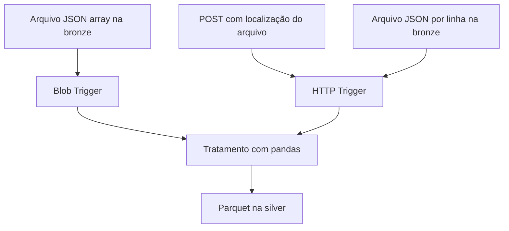

# Azure — ETL de logs de e-commerce com Functions

Projeto educacional da formação Alura que transforma eventos de e-commerce e grava Parquet no Azure Blob Storage. Duas implementações exploram formas de acionar o processamento: chegada de um blob e requisição HTTP.

A documentação descreve o código analisado, sem afirmar implantação ou execução validada nesta revisão. As versões têm contratos distintos e não são intercambiáveis.

## Objetivo e arquitetura

Tratar registros sem identificação de usuário, normalizar dispositivo e preço, converter timestamps e organizar a saída silver por data.



O nó de tratamento resume a finalidade das duas funções. As implementações divergem no tratamento de preço inválido e no caminho de saída.

## Tecnologias e estrutura

Python, Azure Functions, Azure Blob Storage, pandas e PyArrow.

| Caminho relativo a Azure | Conteúdo |
|---|---|
| `etl-ecommerce-blobtrigger/function_app.py` | Gatilho de blob e transformação |
| `etl-ecommerce-httptrigger/function_app.py` | Endpoint HTTP e transformação |
| `host.json` em cada função | Configuração do host |
| `requirements.txt` em cada função | Dependências declaradas |
| `Aula 1.md` e `Aula2.md` | Anotações de estudo |

## Contratos de entrada

### Blob Trigger

O binding observa `bronze/{ano}/{mes}/{dia}/{name}.json`. O conteúdo passa por `json.loads` e deve ser uma lista de objetos.

Exemplo fictício de `bronze/2026/11/08/logs.json`:

```json
[
  {"user_id":"u001","device":null,"price":"19,90","timestamp":"2026-11-08T12:00:00Z"},
  {"user_id":"u002","device":"mobile","price":"invalido","timestamp":"2026-11-08T12:01:00Z"}
]
```

### HTTP Trigger

O POST informa a localização de um arquivo existente, não os eventos diretamente:

```json
{"folderPath":"2026/11/08","fileName":"logs.json"}
```

A função lê o blob `2026/11/08/logs.json` no contêiner `bronze`. Cada linha não vazia deve conter um objeto JSON completo:

```json
{"user_id":"u001","device":null,"price":"19,90","timestamp":"2026-11-08T12:00:00Z"}
{"user_id":"u002","device":"mobile","price":"invalido","timestamp":"2026-11-08T12:01:00Z"}
```

O formato é JSON por linha, embora a extensão esperada seja `.json`. Uma lista JSON formatada em várias linhas não atende a esse parser.

## Regras de transformação

| Regra | Blob Trigger | HTTP Trigger |
|---|---|---|
| `user_id` ausente ou falso | Remove registro | Remove registro |
| `device` ausente ou falso | Preenche `unknown` | Preenche `unknown` |
| Preço com vírgula decimal | Troca vírgula por ponto e converte | Mesmo tratamento |
| Preço inválido | `0.0` | Nulo |
| Timestamp inválido | Coerção para `NaT` | Coerção para `NaT` |
| Gravação | Parquet em memória | Parquet em memória |

Para o exemplo, `u001` resulta em dispositivo `unknown` e preço `19.9`. O preço de `u002` resulta em zero no Blob Trigger e nulo no HTTP. São resultados derivados da leitura do código, não de uma execução registrada.

## Saídas

| Versão | Objeto no contêiner silver para o exemplo |
|---|---|
| Blob Trigger | `2026/11/08/logs.json.parquet` |
| HTTP Trigger | `2026/11/08/logs/data.parquet` |

O Blob Trigger acrescenta `.parquet` ao nome original, preservando `.json`. A versão HTTP remove `.json` e cria um diretório para `data.parquet`. Ambas usam `overwrite=True`, substituindo o objeto de mesmo nome.

## Configuração

Pré-requisitos: Python compatível com o runtime escolhido, Azure Functions Core Tools, ambiente virtual e Storage acessível. Para a execução local, configurar armazenamento do host e dos dados. Criar os contêineres `bronze` e `silver`.

A variável `stpipelinedatalake0926_STORAGE` é o nome literal esperado pelo código e pelo binding. Seu valor é uma connection string do ambiente. O nome não deve ser trocado isoladamente sem atualizar as referências no código.

Dentro de cada pasta de função, criar um `local.settings.json` não versionado:

```json
{
  "IsEncrypted": false,
  "Values": {
    "FUNCTIONS_WORKER_RUNTIME": "python",
    "AzureWebJobsStorage": "<CONNECTION_STRING_DO_HOST>",
    "stpipelinedatalake0926_STORAGE": "<CONNECTION_STRING_DOS_DADOS>"
  }
}
```

Os valores entre `<...>` são marcadores que precisam ser substituídos localmente. Nunca são credenciais prontas.

## Execução local

Executar uma implementação por vez na respectiva pasta:

```bash
python3 -m venv .venv
source .venv/bin/activate
python -m pip install -r requirements.txt
python -m pip install pyarrow
func start
```

O segundo comando de instalação explicita o engine exigido por `to_parquet`. A lista HTTP analisada não declara PyArrow, apesar de o código depender dele. Não foi alterado o arquivo original de dependências.

### Teste pelo gatilho de blob

Com o host iniciado, enviar um arquivo JSON array para o caminho de bronze com ano, mês e dia. Acompanhar o log da função e inspecionar o objeto correspondente na silver.

### Teste HTTP

Primeiro enviar o arquivo JSON por linha para a bronze. Com a função HTTP iniciada:

```bash
curl -X POST http://localhost:7071/api/process-ecommerce-logs \
  -H 'Content-Type: application/json' \
  -d '{"folderPath":"2026/11/08","fileName":"logs.json"}'
```

Na nuvem, configurar as mesmas app settings e a autenticação exigida pelo endpoint publicado. Não há um provisionamento integral da infraestrutura descrito nesses arquivos.

## Respostas e observabilidade

A versão HTTP retorna 400 quando faltam `folderPath` ou `fileName`, 200 após processamento e 500 para exceções capturadas. JSON malformado pode cair no tratamento genérico de erro.

No retorno de sucesso, `silver_path` informa o caminho lógico da saída; o objeto final recebe `/data.parquet`. O campo chamado `parquet` contém o caminho bronze no código atual e não deve ser utilizado como endereço do Parquet.

A versão Blob registra arquivo, tamanho e transformações. Há logs com conteúdo de registros: no uso com dados reais, isso exige cuidado com dados pessoais.

## Critérios de validação

- Confirmar remoção de um evento sem `user_id`.
- Conferir preenchimento de `device` e conversão de vírgula decimal.
- Comparar preço inválido nas duas implementações.
- Verificar tipo de timestamp e caminho físico do Parquet.
- Confirmar resposta 400 quando falta um parâmetro HTTP.
- Verificar o efeito de processar o mesmo arquivo novamente.

Esses itens descrevem critérios de aceite; não foram executados nesta revisão.

## Limitações conhecidas

O Blob Trigger chama `transform_records` duas vezes. Entradas totalmente descartadas ou sem colunas esperadas podem causar erro ao acessar `price` ou `timestamp`. O caminho HTTP pressupõe exatamente a organização ano/mês/dia/arquivo. O tratamento de valores inválidos diverge entre versões. Toda leitura e conversão ocorre em memória. Não há evidência de teste de carga, fila de rejeitados ou recuperação validada.

## Conhecimentos demonstrados

Processamento por evento e por requisição, contratos JSON, limpeza com pandas, tipos e timestamps, buffers em memória, Parquet, Blob Storage e configuração de funções serverless.
